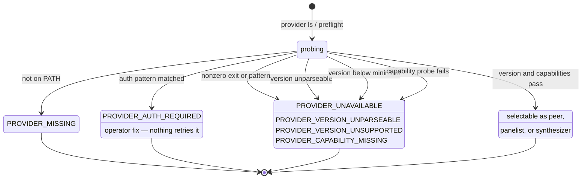
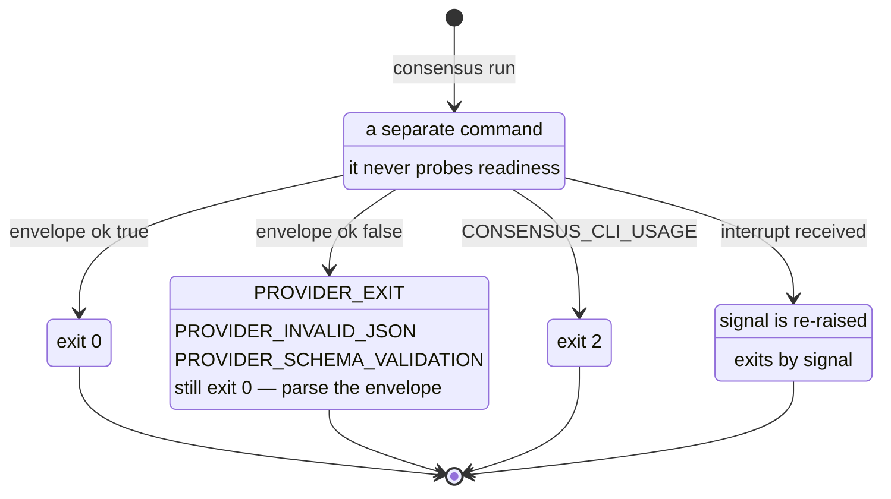

# Provider setup

Check provider readiness before running a peer. Shared workflow defaults live
in [Configuration](configuration.md); per-run output and write policies live
in [Provider run controls](provider-run-controls.md).

## Provider floor, inventory, and preflight

Peer IDs come from provider inventory. The supported provider floor is
`claude`, `codex`, and `cursor`. The [extended providers](#extended-providers)
are experimental and are not part of that floor. Requested peers must be
present and usable in provider inventory and preflight before live use:

```bash
consensus provider ls --json
consensus preflight --json --provider claude --capability run
```

`provider ls` lists the core providers (`claude`, `codex`, `cursor`) only. The
provider CLI also has an extended tier for providers that are used only when
named: `preflight --provider <id>` and `run --provider <id>` resolve any
registered provider, but delegate fallback and panel auto-fill select core
providers only. The extended tier has three providers: `antigravity`, `gemini`,
and `droid`.

Claude Code must be at least 2.1.259. Restricted permission profiles use
`--permission-prompts none`, which the [Claude CLI reference](https://code.claude.com/docs/en/cli-reference#cli-flags)
documents as requiring that version. Older versions fail preflight rather than
being advertised as ready for unsupported profiles.

From a repository checkout the same provider CLI lives at
`plugins/consensus/scripts/consensus.mjs` and can be run with `node`:

```bash
node plugins/consensus/scripts/consensus.mjs provider ls --json
node plugins/consensus/scripts/consensus.mjs preflight --json --provider <selected-provider-id> --capability run
```

### Readiness states

Readiness is a state machine, not a boolean. `consensus run` is a separate
command that never probes. Completed success and provider-failure envelopes
exit 0; usage errors exit 2. An interrupted CLI re-raises the signal and exits
by that signal. The diagram below covers the registered providers; the next
section adds the states a provider with prerequisites or pending admission
could reach (no registered provider has either today).



`consensus run` is a separate command and never probes readiness:



_Mermaid updated 2026-11-13_

### Prerequisites, version pins, and admission

A provider adapter can declare prerequisites: programs that must be installed
before the provider can run, such as a launcher or the agent CLI it starts. No
registered provider declares prerequisites today, and all three extended
providers are admitted; this section describes the mechanism. Probes check prerequisites in order, before the
provider's own binary:

- A prerequisite without a version is checked for presence only. One that is
  not found, or whose override variable is not an absolute path, makes the
  provider `missing` with `PROVIDER_PREREQUISITE_MISSING`.
- A prerequisite with a version pin runs its version command. The pin has
  inclusive `min` and `max` bounds and an optional `exact` version. The
  version is the first complete version token in the output, so `0.2.2-rc.5.`
  does not parse. Versions are compared with their prerelease tag, so `0.2.2`
  and `0.2.2-rc.4` do not match an exact `0.2.2-rc.5`. An exact pin compares
  the token as written, build metadata included: `0.2.2.0` and `00.2.2` do not
  match an exact `0.2.2`, and `0.2.2-rc.5+other` does not match
  `0.2.2-rc.5+approved`. `min` and `max` ignore build metadata, as SemVer
  precedence does.
  A version outside the pin, or output with no parseable version, makes the
  provider `unsupported` with `PROVIDER_PREREQUISITE_VERSION_UNSUPPORTED`. A
  failed version command makes it `unavailable` with
  `PROVIDER_PREREQUISITE_UNAVAILABLE`.
- A pin bound that is not exactly one version, an `exact` pin combined with
  `min` or `max`, or a `min` above its `max`,
  makes the provider `unsupported` with `PROVIDER_PREREQUISITE_PIN_INVALID`
  without running the version command.
- A missing or out-of-pin prerequisite adds `install_hint` to the inventory or
  preflight entry. A provider binary that is missing or fails to start adds the
  adapter's own hint when it has one.

`consensus run` checks the same prerequisites before it starts the provider. A
failure returns `PROVIDER_MISSING`, `PROVIDER_UNSUPPORTED` or
`PROVIDER_UNAVAILABLE` and `continuation.turn: "not_started"`; a missing or
out-of-pin prerequisite also puts its install hint in the message. On success the absolute path of each
checked prerequisite reaches the adapter's invocation builder, so the run
launches what was checked; the override variables that selected them are not
passed to the provider.

A provider can also be registered before it is admitted for use. Probes report
it as `unsupported` with `PROVIDER_NOT_ADMITTED: registered, not admitted:
<reason>`, without launching anything, and `consensus run` refuses it with
`PROVIDER_UNSUPPORTED` before any process starts. Preflight reports
`Requested provider is not registered` only for an ID with no adapter.

## Extended providers

Three extended providers are registered: Antigravity (`antigravity`), Gemini
CLI (`gemini`), and Factory Droid (`droid`). They are **experimental**. Each
passed a live smoke test on 2026-11-21 at the minimum version below, on the
sign-in route its section names as tested: an answer, a read, and an edit
request that changed nothing, with a clean working tree and no leftover
processes. See the [smoke record](https://github.com/tkstang/skills/blob/main/.oat/repo/reference/evidence/2026-11-21-extended-provider-smoke.md). Other routes and later versions are
untested.

Consensus drives each one through its Agent Client Protocol (ACP) command over
the agent's stdin and stdout, with its own client: nothing else is installed or
fetched. They run only when named with `--provider <id>`; `provider ls`,
delegate fallback, and panel auto-fill never pick them.

| Provider    | ID            | Command started                  | Minimum version | Credential variable |
| ----------- | ------------- | -------------------------------- | --------------- | ------------------- |
| Antigravity | `antigravity` | `agy acp`                        | 1.5.13          | `GEMINI_API_KEY`    |
| Gemini CLI  | `gemini`      | `gemini --acp -m <model>`        | 0.70.0          | `GEMINI_API_KEY`    |
| Droid       | `droid`       | `droid exec --output-format acp` | 1.16.0          | `FACTORY_API_KEY`   |

### What every extended run gets

- **Read-only only.** A run needs `--permission-mode read-only` and
  `--output text`. Any other mode, an omitted mode, JSON output, effort,
  `--env-allow`, scoped grants, and native resume are refused before launch
  with `PROVIDER_UNSUPPORTED_OPTION`. `--max-attempts` above 1 is a usage
  error (`CONSENSUS_CLI_USAGE`), so a turn is never repeated.
- **A model you choose.** Pass `--model`, or set
  [`defaults.provider_models`](configuration.md#extended-provider-models).
  With neither, `consensus run` refuses the run before launch with
  `PROVIDER_UNSUPPORTED_OPTION` (`attempts.terminal_reason: "model_required"`).
  Consensus never falls back to the provider's own default model.
- **Read-only setup before the prompt.** Consensus sets the provider's
  read-only mode and the model, and sends the prompt only once the agent has
  confirmed both. An unconfirmed mode or model, a model the agent does not
  offer, or any contrary mode or autonomy update before the prompt fails with
  `PROVIDER_UNSUPPORTED_OPTION` and `turn: "not_started"`. For Antigravity and
  Droid the message lists up to five models on offer. Consensus keeps
  watching the mode: if the agent reports leaving it during the turn, the turn
  is cancelled and fails with `PROVIDER_EXIT` (`acp_mode_changed`).
- **Deny-all.** Every permission request the agent sends is rejected, and the
  client offers the agent no file system or terminal and no MCP servers of its
  own. A turn that is denied a tool and still answers succeeds, with
  `diagnostics.permission_denials` filled; one that ends without an answer
  fails with `PROVIDER_PERMISSION_DENIED`.
- **Redaction.** The values of the provider's credential variables, and
  provider patterns such as Droid's pairing code, are removed from answer
  text, metadata, denial details, working-tree change paths, and stderr.
- **Brief lines.** Before your prompt, consensus adds: "This is a read-only
  run. Use only read and search tools. Do not edit files or run shell
  commands; such requests are denied and end the turn." Some providers get one
  more line, listed below.
- **A working-tree check.** The working directory must be a git checkout.
  Consensus compares HEAD and the tracked and untracked files before and after
  the turn, and fails a run that changed them with
  `PROVIDER_WORKTREE_CHANGED`. Ignored files are not checked; see
  [Provider run controls](provider-run-controls.md#extended-provider-runs).
- **Cleanup.** When the turn ends, consensus closes the session where the agent
  supports that, then stops the agent's whole process group (on Windows, the
  agent process only), even after a normal exit, so helpers the agent started
  do not outlive the run.

### Sign-in

Preflight runs only `<command> --version`, without the provider's credential
variables, checks the minimum version, and reports only the numeric version.
It never opens an ACP session, so `ready` proves neither the sign-in nor the
model; both are first checked by a run.

When the provider's credential variable is set in the environment that starts
consensus, the run authenticates with it, even if you are also signed in;
`diagnostics.acp.auth` is `api_key`. Otherwise the agent uses its own saved
sign-in (`existing_login`). Saved sign-ins usually live in the OS keychain, so
they often fail over a plain SSH session. A run that is not signed in fails
with `PROVIDER_AUTH_REQUIRED` and a hint naming the sign-in command. Only the
listed credential variable is forwarded; `--env-allow` is refused.

### Antigravity

- Install Google Antigravity and its `agy` command, then sign in with
  `agy acp --login` from a desktop terminal, or set `GEMINI_API_KEY`. Both
  routes are smoke-tested.
- With `GEMINI_API_KEY` set, consensus starts `agy` against a private
  temporary settings directory (mode 0700) that selects the Gemini API, and
  removes it after the run.
- Read-only mode is `default`. The model is set through the agent's `model`
  option and must be one it offers.
- Extra brief lines: "Do not use invoke_subagent, swarm, run_workflow or
  schedule." and "Only read files inside the working directory; do not read
  parent directories."
- A quota error that arrives as answer text (`Error 429`,
  `exceeded your current quota`) fails with `PROVIDER_LIMIT_REACHED`; `agent executor error`
  fails with `PROVIDER_EXIT`.
- Accepted limits:
  - `search_web` sends queries over the network without a permission
    request, so deny-all cannot stop it.
  - `agy` writes your real
    `~/.gemini/antigravity-cli/conversation_summaries.db` during a run. It is
    outside the checkout, so the working-tree check does not see it.
  - Sub-agent write requests go to an approval screen that ACP never shows.
    They fail closed after about 60 seconds without telling the client, which
    is why the brief line bans sub-agents and workflows.
  - A read outside the workspace ends the turn. agy asks permission to read
    outside the working directory, for example a parent directory's
    `package.json` or, on the desktop login, its own session transcript in
    its app data. Consensus denies it, and agy ends the turn after that single
    denied read, so the run fails as `PROVIDER_PERMISSION_DENIED` with no
    answer. The brief line asks agy to stay inside the working directory,
    which avoids the parent-directory reads; agy may still ask to read its
    own transcript, in its app data or, in API-key mode, in the private
    settings directory.

### Gemini CLI

- Install with `npm install -g @google/gemini-cli` and set `GEMINI_API_KEY`,
  the smoke-tested route. A saved sign-in from running `gemini` once in a
  terminal may also work, but is untested.
- The model is passed at launch with `-m`, and the session must report it.
- Read-only mode is `plan`, set inside the session. Gemini confirms it with a
  `[MODE_UPDATE] plan` message (or a mode update naming `plan`) before the
  prompt is sent, so the message never reaches the reply.
- No extra brief line.

### Droid

- Install Factory Droid (see the [Factory docs](https://docs.factory.ai)),
  then sign in by running `droid` in a desktop terminal; that keychain sign-in
  is the smoke-tested route. `FACTORY_API_KEY` is accepted but untested.
- Read-only mode is `normal`; Droid's ACP default, `auto-medium`, approves
  writes on its own. The model is set through the agent's `model` option and
  must be one it offers.
- Extra brief line: "Do not use loop, ConnectApp, automation, or cloud/computer
  tools."
- Droid ends the whole turn when a tool is denied, so a denied run fails with
  `PROVIDER_PERMISSION_DENIED`.
- Signed out, Droid answers with a device-pairing code, and starts a new code
  for every session. Consensus redacts the code wherever it reports it.

## Diagnostics

The wrappers surface provider-neutral diagnostics when a requested peer cannot be
used:

- `PROVIDER_MISSING`
- `PROVIDER_AUTH_REQUIRED`
- `PROVIDER_UNAVAILABLE`
- `PROVIDER_VERSION_UNPARSEABLE`
- `PROVIDER_VERSION_UNSUPPORTED`
- `PROVIDER_CAPABILITY_MISSING`
- `PROVIDER_UNSUPPORTED_OPTION`
- `PROVIDER_PREREQUISITE_MISSING`
- `PROVIDER_PREREQUISITE_VERSION_UNSUPPORTED`
- `PROVIDER_PREREQUISITE_UNAVAILABLE`
- `PROVIDER_PREREQUISITE_PIN_INVALID`
- `PROVIDER_NOT_ADMITTED`

When a wrapper reports a peer as unavailable, its error keeps each provider's
`install_hint` and diagnostic warnings from inventory or preflight.

Completed provider `run` results are machine-readable envelopes. Provider
failures such as `ok: false`, `PROVIDER_EXIT`, `PROVIDER_ARGV_TOO_LARGE`,
`PROVIDER_INVALID_JSON`, `PROVIDER_SCHEMA_VALIDATION`, `PROVIDER_EMPTY_OUTPUT`,
`PROVIDER_MALFORMED_RESULT`, and the extended-provider codes
`PROVIDER_PERMISSION_DENIED` and `PROVIDER_WORKTREE_CHANGED` still exit process `0`; shell callers must parse
the JSON envelope instead of checking `$?`. CLI usage failures
(`CONSENSUS_CLI_USAGE`) exit `2`. Interrupts re-raise the signal and exit by it;
they are not covered by the completed-envelope exit-0 guarantee. The peer-facing `consensus submit` subcommand
uses ordinary nonzero exit codes for validation or capture failures so the peer
can correct the verdict in-turn.

## Provider programs

Consensus runs each provider's CLI by name, found on `PATH`: `claude`, `codex`
and `cursor-agent`, and for the extended providers `agy`, `gemini` and
`droid`. Only absolute `PATH` entries are searched; relative and
empty entries are skipped, so a probe and a run started from different
directories find the same binary. A directory named like the program is
skipped too, and on Windows a bare name also matches `<name>.exe` or
`<name>.com`. `consensus run` starts the absolute path it finds, and when
there is none it fails with `PROVIDER_MISSING` before any process starts.
Each run resolves the program again, so a program replaced on `PATH` between
a `preflight` and a later `run` is the one that runs. To run a different program for one provider, set that
provider's variable to the program's absolute path in the environment that
starts consensus:

| Provider      | Variable                           | Default command |
| ------------- | ---------------------------------- | --------------- |
| `claude`      | `CONSENSUS_CLAUDE_EXECUTABLE`      | `claude`        |
| `codex`       | `CONSENSUS_CODEX_EXECUTABLE`       | `codex`         |
| `cursor`      | `CONSENSUS_CURSOR_EXECUTABLE`      | `cursor-agent`  |
| `antigravity` | `CONSENSUS_ANTIGRAVITY_EXECUTABLE` | `agy`           |
| `gemini`      | `CONSENSUS_GEMINI_EXECUTABLE`      | `gemini`        |
| `droid`       | `CONSENSUS_DROID_EXECUTABLE`       | `droid`         |

Unset or empty keeps the default command. Most setups never need these.

### When to use one

Use a provider program when the CLI cannot sign in from the environment
consensus gives it, and a wrapper can supply the credential instead.

The usual case is Cursor. Consensus starts each peer with a reduced
environment: a few base variables (`PATH`, `HOME`, `USER`, `TMPDIR` and similar),
that provider's credential variables (`CURSOR_API_KEY` for Cursor), names the
run explicitly allows, and its own host metadata. An agent's shell often cannot
read the Cursor CLI's own sign-in, so without `CURSOR_API_KEY` Cursor reports
`auth_required` or fails its first turn. Exporting `CURSOR_API_KEY` from every
shell fixes that, but then every process started from those shells, including
every tool an agent runs, can read the key. A wrapper keeps the key out of the
shell and loads it only when consensus starts Cursor.

A minimal macOS wrapper that reads the key from the login keychain:

```sh
#!/bin/sh
# ~/bin/cursor-agent-keyed: run cursor-agent with CURSOR_API_KEY from the keychain.
real="$HOME/.local/bin/cursor-agent"
case "$*" in
  --version | --help) exec "$real" "$@" ;; # readiness probes need no key
esac
CURSOR_API_KEY=$(security find-generic-password -a "$USER" -s cursor-api-key -w) || exit 1
export CURSOR_API_KEY
exec "$real" "$@"
```

Store the key once under that service name. Run this in a terminal; with `-w`
last, `security` prompts for the value, so the key stays out of the command line
and shell history:

```sh
security add-generic-password -a "$USER" -s cursor-api-key -w
```

An item created this way trusts the `security` tool, so the wrapper reads it
without a dialog. That also means any process running as you can read the key
with `security` while the login keychain is unlocked. The wrapper keeps the key
out of every shell's environment, so tools an agent runs do not receive it by
default, but it does not restrict who can read the keychain item.

Then export the path from a file that non-interactive shells also read, since
agents usually run commands in one (for zsh, `~/.zshenv`):

```sh
export CONSENSUS_CURSOR_EXECUTABLE="$HOME/bin/cursor-agent-keyed"
```

Keep the wrapper outside the CLI's own install directory. Cursor's updater
rewrites `~/.local/bin/cursor-agent` on each update and would replace a wrapper
installed there.

The same setting can also pin a specific CLI build that is not first on `PATH`.
If the CLI already works from your agent shells, leave the variable unset.

### How a provider program is run

- **Only the parent environment sets it.** Consensus reads the variable from
  the environment of the process that runs it, normally the host agent's shell.
  Run requests, config files and briefs cannot set it, so a repository cannot
  choose which program runs.
- **It must be an absolute path.** A relative path would resolve against each
  run's working directory, often the repository under review. A relative value
  makes `provider ls` and `preflight` report the provider as `missing`, and
  `consensus run` fails with `PROVIDER_MISSING` before starting any process.
- **Readiness probes and runs use its resolved path.** `provider ls` and
  `preflight` run the program they found, by its absolute path, with
  `--version`, and `consensus run` starts that same path. `preflight --capability run` also runs it with `--help`
  (`exec --help` for Codex; `--version` again for an extended provider). Both apply the same version and capability checks
  as for the default CLI, so a wrapper must pass these arguments through to the
  real CLI unchanged. A wrapper that skips its credential for probes, as above,
  can report `ready` while a run still fails, for example when the keychain is
  locked. Confirm with a real run.
- **It gets the same reduced environment.** The program receives exactly what
  the default CLI would, and the `CONSENSUS_<PROVIDER>_EXECUTABLE` variable
  itself is not passed on. A keychain read needs the login keychain unlocked,
  so it fails over a plain SSH session.
- **Diagnostics show the path.** Inventory `executable` and run
  `redacted_command` name the program that ran.

## Cursor auth

Cursor is included in the provider floor, but local auth state is still
operator-owned. If inventory or preflight reports Cursor as `auth_required`,
unlock the OS keychain or authenticate the Cursor CLI in the current user session
before retrying. When agent shells cannot read the Cursor sign-in, either export
`CURSOR_API_KEY`, which consensus forwards to Cursor, or set
`CONSENSUS_CURSOR_EXECUTABLE` to a wrapper that loads it (see
[Provider programs](#provider-programs)). Cursor submit-tool support is reserved
for a later acceptance path and is not selected by default.
