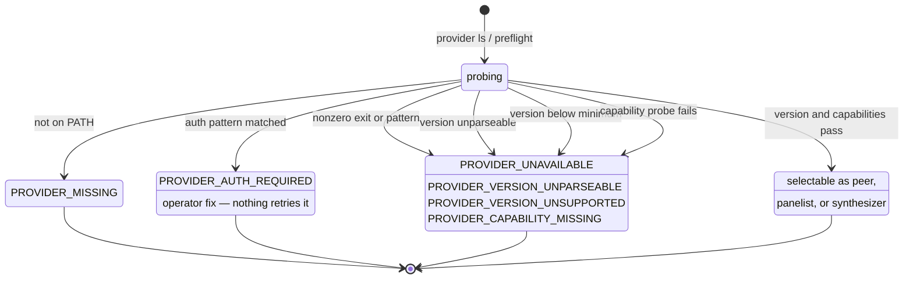
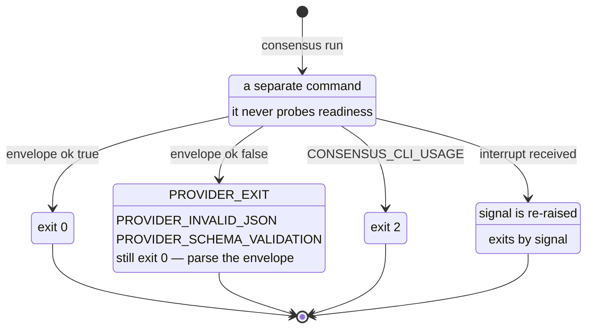

# Provider setup

Check provider readiness before running a peer. Shared workflow defaults live
in [Configuration](configuration.md); per-run output and write policies live
in [Provider run controls](provider-run-controls.md).

## Provider floor, inventory, and preflight

Peer IDs come from provider inventory. The first supported provider floor is
`claude`, `codex`, and `cursor`; future providers are extension points, not v0.1
support claims. Requested peers must be present and usable in provider inventory
and preflight before live use:

```bash
consensus provider ls --json
consensus preflight --json --provider claude --capability run
```

Claude Code must be at least 2.1.259. Restricted permission profiles use
`--permission-prompts none`, which the [Claude CLI reference](https://code.claude.com/docs/en/cli-reference#cli-flags)
documents as requiring that version. Older versions fail preflight rather than
being advertised as ready for unsupported profiles.

From a repository checkout the same provider CLI lives at
`plugins/consensus/scripts/consensus.mjs` and can be run with `node`:

```bash
node plugins/consensus/scripts/consensus.mjs provider ls --json
node plugins/consensus/scripts/consensus.mjs preflight --json --provider <selected-provider-id> --capability run
```

### Readiness states

Readiness is a state machine, not a boolean. `consensus run` is a separate
command that never probes. Completed success and provider-failure envelopes
exit 0; usage errors exit 2. An interrupted CLI re-raises the signal and exits
by that signal.



`consensus run` is a separate command and never probes readiness:



_Mermaid updated 2026-11-13_

## Diagnostics

The wrappers surface provider-neutral diagnostics when a requested peer cannot be
used:

- `PROVIDER_MISSING`
- `PROVIDER_AUTH_REQUIRED`
- `PROVIDER_UNAVAILABLE`
- `PROVIDER_VERSION_UNPARSEABLE`
- `PROVIDER_VERSION_UNSUPPORTED`
- `PROVIDER_CAPABILITY_MISSING`
- `PROVIDER_UNSUPPORTED_OPTION`

Completed provider `run` results are machine-readable envelopes. Provider
failures such as `ok: false`, `PROVIDER_EXIT`, `PROVIDER_ARGV_TOO_LARGE`,
`PROVIDER_INVALID_JSON`, `PROVIDER_SCHEMA_VALIDATION`, `PROVIDER_EMPTY_OUTPUT`,
or `PROVIDER_MALFORMED_RESULT` still exit process `0`; shell callers must parse
the JSON envelope instead of checking `$?`. CLI usage failures
(`CONSENSUS_CLI_USAGE`) exit `2`. Interrupts re-raise the signal and exit by it;
they are not covered by the completed-envelope exit-0 guarantee. The peer-facing `consensus submit` subcommand
uses ordinary nonzero exit codes for validation or capture failures so the peer
can correct the verdict in-turn.

## Provider programs

Consensus runs each provider's CLI by name, found on `PATH`: `claude`, `codex`
and `cursor-agent`. To run a different program for one provider, set that
provider's variable to the program's absolute path in the environment that
starts consensus:

| Provider | Variable                      | Default command |
| -------- | ----------------------------- | --------------- |
| `claude` | `CONSENSUS_CLAUDE_EXECUTABLE` | `claude`        |
| `codex`  | `CONSENSUS_CODEX_EXECUTABLE`  | `codex`         |
| `cursor` | `CONSENSUS_CURSOR_EXECUTABLE` | `cursor-agent`  |

Unset or empty keeps the default command. Most setups never need these.

### When to use one

Use a provider program when the CLI cannot sign in from the environment
consensus gives it, and a wrapper can supply the credential instead.

The usual case is Cursor. Consensus starts each peer with a reduced
environment: a few base variables (`PATH`, `HOME`, `USER`, `TMPDIR` and similar),
that provider's credential variables (`CURSOR_API_KEY` for Cursor), names the
run explicitly allows, and its own host metadata. An agent's shell often cannot
read the Cursor CLI's own sign-in, so without `CURSOR_API_KEY` Cursor reports
`auth_required` or fails its first turn. Exporting `CURSOR_API_KEY` from every
shell fixes that, but then every process started from those shells, including
every tool an agent runs, can read the key. A wrapper keeps the key out of the
shell and loads it only when consensus starts Cursor.

A minimal macOS wrapper that reads the key from the login keychain:

```sh
#!/bin/sh
# ~/bin/cursor-agent-keyed: run cursor-agent with CURSOR_API_KEY from the keychain.
real="$HOME/.local/bin/cursor-agent"
case "$*" in
  --version | --help) exec "$real" "$@" ;; # readiness probes need no key
esac
CURSOR_API_KEY=$(security find-generic-password -a "$USER" -s cursor-api-key -w) || exit 1
export CURSOR_API_KEY
exec "$real" "$@"
```

Store the key once under that service name. Run this in a terminal; with `-w`
last, `security` prompts for the value, so the key stays out of the command line
and shell history:

```sh
security add-generic-password -a "$USER" -s cursor-api-key -w
```

An item created this way trusts the `security` tool, so the wrapper reads it
without a dialog. That also means any process running as you can read the key
with `security` while the login keychain is unlocked. The wrapper keeps the key
out of every shell's environment, so tools an agent runs do not receive it by
default, but it does not restrict who can read the keychain item.

Then export the path from a file that non-interactive shells also read, since
agents usually run commands in one (for zsh, `~/.zshenv`):

```sh
export CONSENSUS_CURSOR_EXECUTABLE="$HOME/bin/cursor-agent-keyed"
```

Keep the wrapper outside the CLI's own install directory. Cursor's updater
rewrites `~/.local/bin/cursor-agent` on each update and would replace a wrapper
installed there.

The same setting can also pin a specific CLI build that is not first on `PATH`.
If the CLI already works from your agent shells, leave the variable unset.

### How a provider program is run

- **Only the parent environment sets it.** Consensus reads the variable from
  the environment of the process that runs it, normally the host agent's shell.
  Run requests, config files and briefs cannot set it, so a repository cannot
  choose which program runs.
- **It must be an absolute path.** A relative path would resolve against each
  run's working directory, often the repository under review. A relative value
  makes `provider ls` and `preflight` report the provider as `missing`, and
  `consensus run` fails with `PROVIDER_MISSING` before starting any process.
- **Readiness probes run it.** `provider ls` and `preflight` run the program
  with `--version`. `preflight --capability run` also runs it with `--help`
  (`exec --help` for Codex). Both apply the same version and capability checks
  as for the default CLI, so a wrapper must pass these arguments through to the
  real CLI unchanged. A wrapper that skips its credential for probes, as above,
  can report `ready` while a run still fails, for example when the keychain is
  locked. Confirm with a real run.
- **It gets the same reduced environment.** The program receives exactly what
  the default CLI would, and the `CONSENSUS_<PROVIDER>_EXECUTABLE` variable
  itself is not passed on. A keychain read needs the login keychain unlocked,
  so it fails over a plain SSH session.
- **Diagnostics show the path.** Inventory `executable` and run
  `redacted_command` name the program that ran.

## Cursor auth

Cursor is included in the provider floor, but local auth state is still
operator-owned. If inventory or preflight reports Cursor as `auth_required`,
unlock the OS keychain or authenticate the Cursor CLI in the current user session
before retrying. When agent shells cannot read the Cursor sign-in, either export
`CURSOR_API_KEY`, which consensus forwards to Cursor, or set
`CONSENSUS_CURSOR_EXECUTABLE` to a wrapper that loads it (see
[Provider programs](#provider-programs)). Cursor submit-tool support is reserved
for a later acceptance path and is not selected by default.
