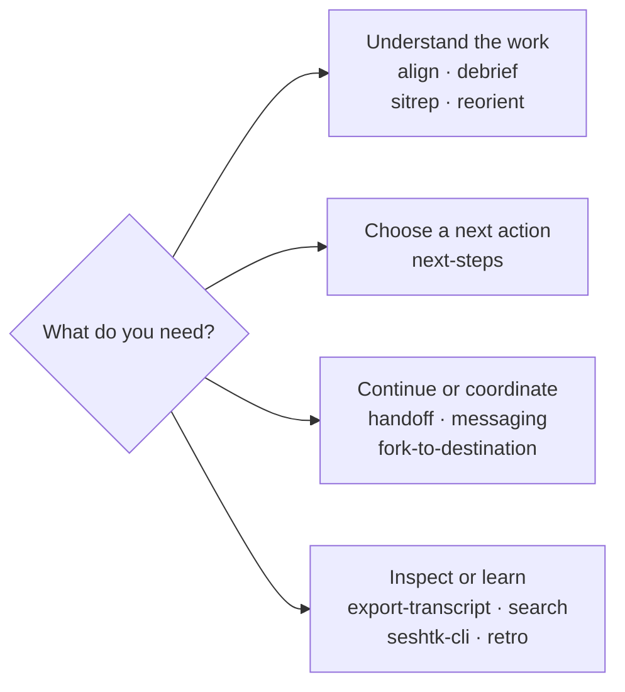

# Session

The Session plugin helps you understand the work, choose what comes next,
continue it elsewhere, coordinate local sessions, and learn from session
evidence. Pick the capability that answers your question; these skills are not
a required sequence.

## Choose by intent

_Mermaid updated 2026-10-30_

| What you need                                           | Skill                                                              | What it produces                                                                                                                  |
| ------------------------------------------------------- | ------------------------------------------------------------------ | --------------------------------------------------------------------------------------------------------------------------------- |
| Check that the agent understands your goals and problem | [Align](../../skills/align.md)                                     | An explicit alignment exchange about intent, success criteria, assumptions, and direction; no project changes.                    |
| Catch up on what happened while you were away           | [Debrief](../../skills/debrief.md)                                 | A concise account of an interval from visible session history only; no tools or recommendation.                                   |
| See where the work stands against its goal              | [Sitrep](../../skills/sitrep.md)                                   | Current progress, remaining commitments, risks, and open questions from established sources checked read-only; no recommendation. |
| Regain the big picture of a long or compacted thread    | [Reorient](../../skills/reorient.md)                               | The whole thread's arc from its full transcript, current state with drift checked, and a recommendation.                          |
| Decide the next action and understand why               | [Next Steps](../../skills/next-steps.md)                           | A justified recommendation and who can take it; the skill does not execute it.                                                    |
| Let another agent or person continue the work           | [Handoff](../../skills/session-handoff.md)                         | Portable goals, state, decisions, evidence, remaining work, and approval boundaries.                                              |
| Exchange addressed work across local sessions           | [Messaging](../../skills/agent-messaging.md)                       | A durable inbox and shared log, with manual fallback and separately verified finite delivery.                                     |
| Continue native history in another existing worktree    | [Fork to Destination](../../skills/session-fork-to-destination.md) | Alpha native-fork guidance with optional supported history import; it creates no native fork and transfers no worktree changes.   |
| Keep a readable conversation archive                    | [Export Transcript](../../skills/session-export-transcript.md)     | Sanitized Markdown to review before sharing; an archive, not native session transfer.                                             |
| Find a past Claude Code, Codex, or Cursor session       | [Search](../../skills/session-search.md)                           | Ranked, redacted candidates with resume hints; reads local stores without writing to them.                                        |
| Use or understand Session Toolkit commands              | [Seshtk CLI](../../skills/seshtk-cli.md)                           | A verified command workflow with explicit session selection, coverage, and artifact paths; execution requires the external CLI.   |
| Learn from an invocation or bounded episode             | [Retro](../../skills/session-retro.md)                             | Evidence-backed lessons and improvement proposals; it does not apply them.                                                        |

### Understand, report, or recommend

Align checks **what you mean** and runs only when explicitly invoked. Debrief
reports **what happened over an interval**, using only history already visible.
Sitrep reports **where the established work stands now**, and can check the
sources it already uses read-only. Next Steps recommends **what should happen
next**, without starting it.

Reorient is the broader choice when the whole thread has become hard to follow.
It recovers the full transcript through Export Transcript, checks current state,
and recommends a next action; it labels the result partial when history cannot
be recovered. Retro instead reviews a bounded episode for lessons, from a
different exact reviewing session, with frozen transcript and activity evidence.

Debrief and Sitrep may point to Next Steps when work remains, but never invoke
it. That pointer uses the local `next-steps` member in Session; standalone
installs can use the standalone skill. Their presence does not make these skills
a required sequence.

[Seshtk CLI](../../skills/seshtk-cli.md) is a broad entrypoint for toolkit
identity, discovery, reads, search, export, sensitive activity, and Codex
evidence. The dedicated Search and Export Transcript skills remain independent
choices with their own bundled runtimes.

## Installation and names

Install the Session plugin using the [Installation guide](../../installation.md).
Every member also has a standalone form. Align, Debrief, Sitrep, and Next Steps keep the same names in both forms:

| Plugin-local name     | Standalone name               |
| --------------------- | ----------------------------- |
| `align`               | `align`                       |
| `debrief`             | `debrief`                     |
| `sitrep`              | `sitrep`                      |
| `reorient`            | `reorient`                    |
| `next-steps`          | `next-steps`                  |
| `handoff`             | `session-handoff`             |
| `messaging`           | `agent-messaging`             |
| `fork-to-destination` | `session-fork-to-destination` |
| `export-transcript`   | `session-export-transcript`   |
| `search`              | `session-search`              |
| `seshtk-cli`          | `seshtk-cli`                  |
| `retro`               | `session-retro`               |

The linked guides cover both forms. For example, Claude Code uses `/align` for
a standalone install and `/session:align` for the Session member. Other hosts
use their own invocation syntax; packaging alone does not prove live discovery
or permissions.

Align, Debrief, Sitrep, and Next Steps are instruction-only and have no runtime
or package dependencies. The `seshtk-cli` member requires Node.js 22+ and the
external `@tkstang/session-toolkit` package for execution (verified baseline
0.1.0). Installing the plugin does not install that CLI; explanations need no
CLI installation, and the skill does not automatically download it.

Session does not require Consensus. [Observer](../../skills/session-observer.md)
and [Collaborative Observer](../../skills/session-observer-collab.md) are available
standalone and as **Consensus members only**, with no Session membership.
Messaging can integrate with an exact active Collaborative Observer owner when
the installed adapter proves that capability; neither observer is a Session
dependency.

Fork to Destination remains alpha, with incomplete provider and end-to-end
verification. Keep the [installation verification limits](../../installation.md)
in view for the plugin and its members.

## Contents

### Understand the work

- [Align](../../skills/align.md) — Explicitly check understanding of goals, problems, and success criteria.
- [Debrief](../../skills/debrief.md) — Explain what happened from the visible history of an interval.
- [Sitrep](../../skills/sitrep.md) — Report current progress against the established goal.
- [Reorient](../../skills/reorient.md) — Rebuild the full thread's arc and recommend what comes next.

### Choose a next action

- [Next Steps](../../skills/next-steps.md) — Recommend a justified action without executing it.

### Continue or coordinate

- [Handoff](../../skills/session-handoff.md) — Prepare portable continuation context.
- [Messaging](../../skills/agent-messaging.md) — Exchange addressed messages with explicit receipt and delivery boundaries.
- [Fork to Destination](../../skills/session-fork-to-destination.md) — Prepare alpha native-fork guidance, with optional supported history import.

### Inspect or learn

- [Export Transcript](../../skills/session-export-transcript.md) — Save a sanitized conversation archive.
- [Search](../../skills/session-search.md) — Find a past local session from a fuzzy description.
- [Seshtk CLI](../../skills/seshtk-cli.md) — Explain or run Session Toolkit commands using the external CLI.
- [Retro](../../skills/session-retro.md) — Review a bounded episode and propose improvements.
