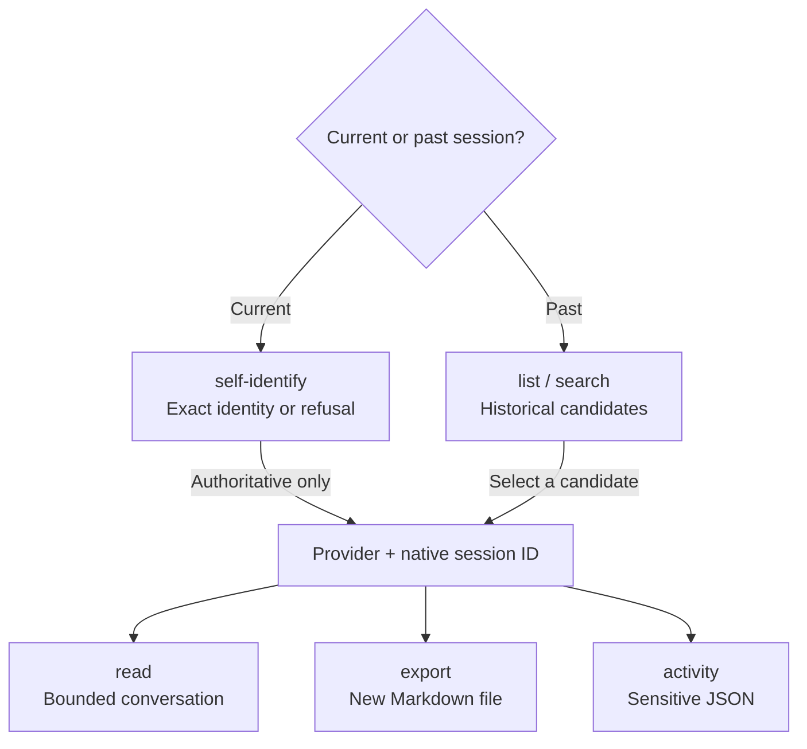

# Session Toolkit

Session Toolkit gives terminal users and JavaScript applications access to local
Claude Code, Codex, and Cursor sessions. Use it to find an earlier conversation,
read a bounded transcript, or save a sanitized Markdown copy.

## Install and try it

Requires Node.js 22 or later. Release checks run on Node 22.0.0 and 24.

```sh
npm install --global @tkstang/session-toolkit@0.1.0
seshtk --version
seshtk search -p 'deployment failed' --literal --since 7d
```

Search returns separate `runtime` and `sessionId` fields. Combine them as
`runtime:sessionId` to select a result; `list` already provides that value in its
`session` field. For a Codex result, replace `SESSION_ID` below with its native ID:

```sh
seshtk read --session 'codex:SESSION_ID' --max-records 100 --json
seshtk export --session 'codex:SESSION_ID' --out ./conversation.md --json
```

Reads and exports default to 4,000,000 source bytes. Export can exit 0 with a
partial conversation: check the Markdown `Source coverage` line or JSON
`data.written[].coverage`. If the byte budget is the limit, increase `--max-bytes`
and export to a new file. Export has no continuation.

Add `--cwd /path/to/repo` to start a search in a repository. Search widens if the
hint finds no matches. `list --cwd /path/to/repo` browses historical candidates;
`self-identify` separately checks exact current-session evidence.

For agent-guided CLI use, choose [Seshtk CLI](../skills/seshtk-cli.md), available
standalone or as Session `seshtk-cli`. It checks the external executable and
capabilities before running commands; explanation-only requests need no install.
Use `seshtk` directly for terminal commands. For application integration, install
the package locally and use the [library](library.md).

## Choose a starting point



_Mermaid updated 2026-10-30_

| I want to…                    | Command                                             |
| ----------------------------- | --------------------------------------------------- |
| Identify this exact session   | `self-identify` — requires authoritative evidence   |
| Find a past conversation      | `search` or `list`, then select a candidate         |
| Read a selected conversation  | `read`                                              |
| Save conversational Markdown  | `export` — check coverage and review before sharing |
| Inspect raw recorded activity | `activity` — sensitive JSON                         |

If exact current identity is unavailable, historical candidates remain useful,
but choosing one does not establish that it is the current session.

## Coverage and privacy

Every read has finite bounds; inspect coverage and continuation fields before
claiming a complete history. Provider formats can change, and inaccessible or
malformed sources report gaps. Exact cutoff/expansion evidence is Codex-only.
Cursor activity cannot supply individual tool results, per-call outcomes, or
usage absent from its transcript surface.

Raw records, evidence, and activity are sensitive. Markdown export removes hidden
instructions and control payloads, but visible conversation and tool text may
still contain credentials. Review exports before sharing. Output files are
created exclusively; existing files and symlinks are not overwritten.

Operations read local session stores without modifying them. Interactive CLI
operations may check npm for an update; JSON, CI, noninteractive invocations, and
library calls perform no update lookup. Set `SESHTK_NO_UPDATE_CHECK=1` to disable
interactive checks too. See [update notices](cli.md#update-notices).

## Contents

- [Seshtk CLI Skill](../skills/seshtk-cli.md) — Ask an agent to explain or run a verified toolkit command workflow.
- [CLI Reference](cli.md) — Commands, machine output, errors, capabilities, and update configuration.
- [Historical Search](search.md) — Patterns, widening, scan authorization, diagnostics, and accelerators.
- [Transcripts and Export](transcripts.md) — Identity, discovery, source coordinates, bounds, evidence, and safe export.
- [Sensitive Activity](activity.md) — Full captured records, recorded tool activity, and provider gaps.
- [Library Reference](library.md) — Public ESM functions, types, explicit stores, and import behavior.
